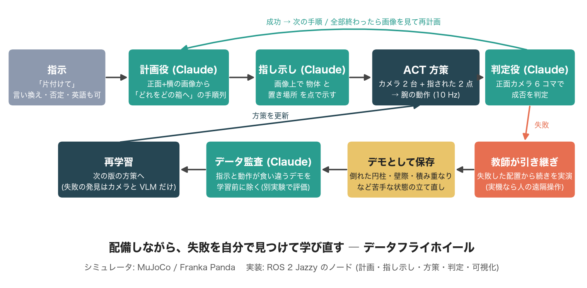
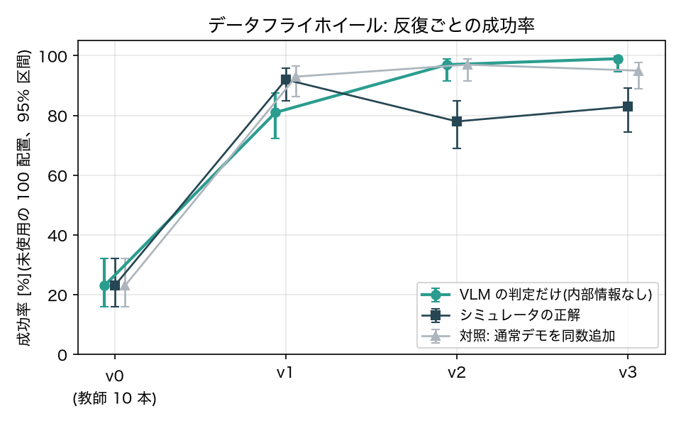
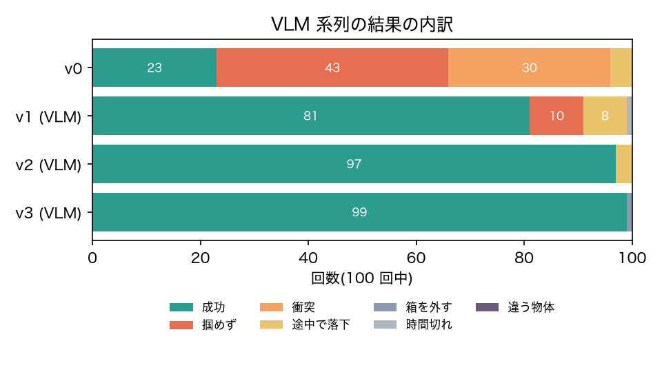
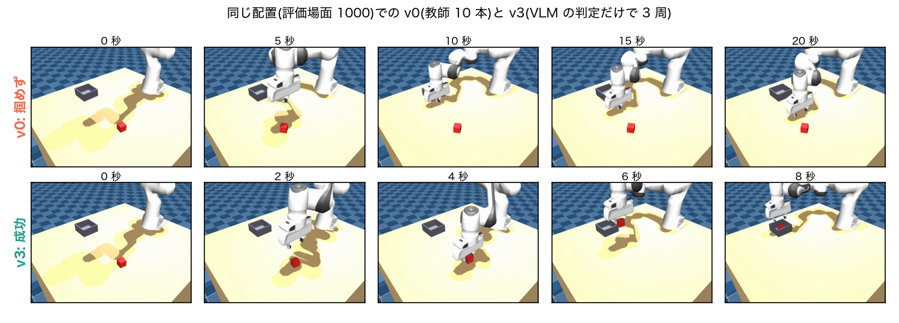
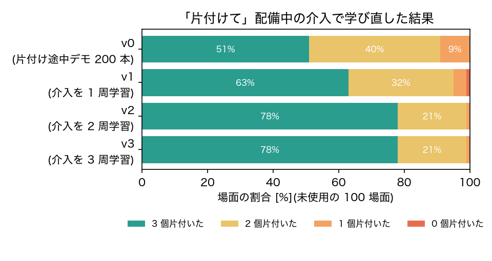
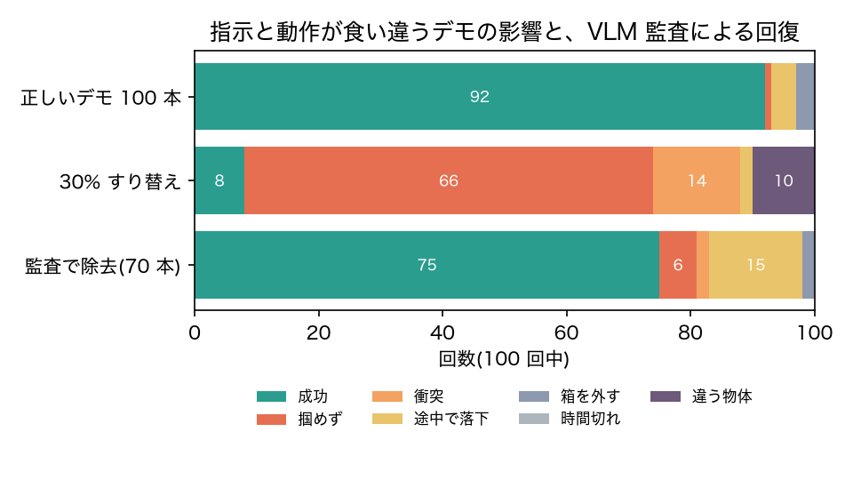

# 見て、直して、学び直す片付けロボット — 言語指示 × VLM の自己点検 × データフライホイール

Physical AI 講座 2026 応用編1 最終課題「AI×ロボティクスによる創造的タスクの実現」
<!-- 氏名・所属・メールは書かない(10/19 改訂版要件)。PDF は scripts/build_report.py で生成する。 -->

## 1. 概要

「片付けて」と一言いうと、シミュレータ上の 7 自由度アーム(Franka Panda)が、卓上の 3 つの物体をカメラで見て 2 つの箱へ片付ける。
役割は 3 層に分けた。**LLM** が指示を「どの物をどの箱へ、どの順に」に分解し、**VLM** が画像上で物体と箱の中の置き場所を指し示し、
**視覚模倣学習の方策(ACT)** が実際に腕を動かす。1 巡したら LLM がもう一度カメラを見て、失敗した物体を計画し直す。

本成果物のポイントは、ロボットが**シミュレータの内部情報を使わず、自分のカメラ映像だけで**以下 3 つの要素を実行できるようにしたことである。

1. **自分の失敗に気づく**: VLM が映像だけで成否を判定する。保存済みの評価動画 128 本で 98.4% がシミュレータの正解と一致した。
2. **失敗から学び直す**: VLM が見つけた失敗場面について、教師に「その場からの立て直し方」を示させ、方策を学習し直す(データフライホイール)。
3. **教えるデータを点検する**: 指示と動作が食い違ったデモを VLM で見つけて除く(データ監査)。

それぞれの効果を、学習に使っていない 100 通りの初期配置で、信頼区間つきで測定した。

- 動画: https://youtu.be/2z__IyOKU4E / コード: https://github.com/takerunakao/physical-ai-advanced1-tidy-flywheel

## 2. 課題設定と狙い

実機のロボット学習で一番の手間は、モデルの構造よりも**データの面倒を見ること**である。どこで失敗したかを人が見て確かめ、
直すためのデモを足し、混ざった悪いデモを取り除く。シミュレータなら成否は内部状態から分かるが、実機にはその「正解」がない。
本成果物では、この見張り役をカメラと VLM に任せ、言語で指示できる片付けロボットの上で回るようにした。

- **創造性**: 片付けの成否そのものではなく、「自分で気づき、直し、点検する」過程を成果物に実装した。言語の指示から実行・自己点検までを 1 本に接続した。
- **技術力**: LLM による計画、VLM による指し示しと判定、視覚模倣学習、HG-DAgger 型の補正デモ、ROS 2 による分散構成、統計的な評価。
- **実用性**: データは LeRobotDataset、制御は ROS 2 のトピックとサービスで、シミュレータを実機ドライバに差し替えれば同じ仕組みが使える。判定・監査に使うのは実機でも手に入るカメラ映像のみである。

## 3. システム

- **言語は方策に入れない**。方策が受け取るのは「画像上の 2 点」(掴む物体の中心と、箱の中の置き場所)だけで、人が画面をタップして与えることもできる。言語の理解は VLM に、運動は方策に任せる分担にした。
- 学習データでは 2 点をシミュレータの正確な位置から計算し、運用時は VLM が指した点に置き換える。
- ROS 2(Jazzy, Docker)で sim / teacher / policy / recorder / video の各ノードに分けた。ロックステップにして決定論性を取った(同じ seed なら同じ結果)。
- 方策の入力は正面カメラと手首カメラの画像(128 px)、手先の状態、画像上の 2 点。行動は手先の移動量 (dx, dy, dz, dyaw) と把持の 5 次元。物体の真の位置は記録するが方策の入力には入れない。

## 4. 方法

### 4.1 言語指示で動く方策と、全体を片付けるループ

- **教師**: 物体と置き場所を知る段階機械(接近 → 降下 → 把持 → 持ち上げ → 運搬 → 降下 → 解放 → 退避)。成功かつ無衝突のデモだけを学習に使う。
- **データの工夫**:
    - 箱の中の置き場所をエピソードごとにランダムにずらし、その点を目標点として与える。方策は「指された所に置く」ことを覚え、2 個目を 1 個目の隣に置ける。
    - 半分のデモは「すでに 1 個が箱に入っている状態」から始める。順に片付ける途中の場面を学習に含めるためである。
- **全体ループ**(`scripts/tidy_all.py`): 計画 → 1 物体ずつ指し示し → 実行 → 原位置へ戻る → 再計画。物体が全部箱に入ったと LLM が判断したら終える。
- **指し示しの補正**: 斜めから見た箱の「中」を VLM に指させると、底面ではなく壁の中ほど(高さ 3 cm)を指していた。この高さで画像から 3 次元に戻すと、置き場所の系統誤差(約 5 cm)が消えた。
- 上からのカメラも試したが、腕が物体を隠すため使わなかった。

### 4.2 VLM による失敗判定

- 1 エピソードの映像から等間隔に 6 コマを取り、VLM に成否と失敗の種類(把持せず、落下、箱外、保持のまま時間切れ、衝突、違う物体)を答えさせる。出力は構造化した JSON。

### 4.3 データフライホイール(内部情報あり/なし/対照)
1. 方策 vK を「運用中」の初期配置 100 通りで実行し、失敗した配置を集める。
2. 失敗した配置ごとに、方策を途中まで走らせてから教師に引き継ぎ、立て直す軌跡だけを記録する(補正デモ)。
3. 元のデータに補正デモを足して vK+1 を学習する。

手順 1 の「失敗」を次の 3 通りで決めて比べた。

- **正解あり**: シミュレータの成否で決める。
- **VLM**: 判定器の答えで決める。内部情報は使わない。
- **対照**: 失敗を集めず、補正デモと同じ数のふつうの教師デモを足す。

### 4.4 データ監査

- 複数物体のデモ 100 本のうち 30 本の指示を、別の物体の指示と目標点にすり替える。例えば、赤い立方体を片付けた映像に「青い立方体を黒い箱へ」と付ける。
- VLM は、データセットに入っている前カメラの映像(128 px)と指示文だけを見て、「腕が実際に動かした物体と箱」と「指示と合うか」を答える。
- 合わないと判定されたデモを除いて学習し直す。

### 4.5 評価

- 学習にも失敗収集にも使わない固定の 100 配置(seed 1000–1099)で成功率を測り、Wilson の 95% 信頼区間を付ける。
- 失敗は自動で分類し、動画で保存する。
- 失敗収集用の配置(2000+)とは必ず分ける。

## 5. 結果

### 5.1 VLM は映像だけで失敗に気づけるか
| 対象 | エピソード数 | 成否の一致率 | 失敗の検出率 | 成功を失敗と誤判定 |
|---|---|---|---|---|
| 保存済みの評価動画 | 128 | 98.4% | 113/115 | 0 |
| フライホイール運用中(b10-v0) | 100 | 99% | 69/69 | 1 |

- 失敗の**種類**まで当たったのは 57% だった。
    - 衝突で終わった 41 回のうち 40 回を「把持せず」と答えた。腕と机の接触は 6 コマでは見えず、結果として掴めていないので、答え自体は筋が通っている。
    - 少し持ち上がってから落ちた回も、「把持せず」と区別できなかった。
- フライホイールに必要なのは成否だけなので、判定器として十分に使える。

### 5.2 指し示し(Claude、調整に使っていない 40 場面)
| 指標 | 結果 |
|---|---|
| 正しい物体を指した | 100% |
| 正しい箱を指した | 100% |
| 置き場所として使える点(壁から 1 cm 以上、すでに箱に入っている物体から 5 cm 以上) | 85% |
| 空の箱で 2 個目の余地を残した | 100% |
| 物体の位置の誤差(中央値) | 1.9 mm |

### 5.3 「片付けて」の一言で全部片付けられるか
| 実行者 | 場面 | 3 個とも片付いた | 平均の小タスク数 |
|---|---|---|---|
| 教師(上限の目安) | 10 | 10/10 | 3.6 |
| 学習済み方策 m3-v0(置き場所をそのまま使用) | 20 | 8/20 | 5.0 |
| 学習済み方策 m3-v0(置き場所をデモの位置に合わせ、試行履歴を計画に渡す) | 20 | **15/20** | 4.4 |
| 学習済み方策 s200-v0(片付け途中の状態で学習、改善 1 も適用) | 20 / 40 | 12/20 / 20/40 | 4.2 / 4.3 |
| 学習済み方策 d200-v2(配備中の介入 36 本を足して学習し直し、§5.5) | 100 | **78/100** | — |

- 最初の版は 6/10 だった。原因は 2 つあった。
    - 空の箱の真ん中に置いてしまい、2 個目が入らなかった。
    - 箱の縁に載った物体を、計画側が「片付いた」と誤認した。
- 指示文を直して 10/10 になった。再計画で失敗を拾い直した場面もある。
- **学習済み方策の失敗の切り分け**(指示 100 件を分析)
    - 空の箱へ入れる指示は 35/53 成功、すでに 1 個入っている箱へ入れる指示は 14/47 しか成功しなかった。
    - VLM が示す置き場所は箱の中心から最大 5 cm、向きもまちまちで、デモの分布(中心から ±3 cm)から外れていた。
    - 置き場所に正解の点を与えても 55% にとどまった。弱点は VLM ではなく、**方策が「箱にすでに物体が入っている」状態をほとんど見ていない**ことにある。
- 改善 1(実行時): VLM が選んだ箱の左右どちら側に置くかはそのまま使い、点だけをデモの位置に合わせた。さらに、計画役に「これまで実行した手順」を渡し、2 回やっても片付かない物体は別の箱へ回させた。成否はシミュレータからではなく、計画役が画像から判断する。これで 8/20 → 15/20。
- 改善 2(学習側): 箱の中にすでに 0〜2 個が任意の位置・向きで入っている「片付け途中」の状態から始めるデモ 200 本で学習し直した(s200)。

#### 指示の言い換えへの対応(教師が実行、5 場面 × 6 指示)

| 指示 | 指示どおりの最終配置 |
|---|---|
| 片付けて | 5/5 |
| キューブは黒い箱に、円柱は白い箱に入れて | 4/5 |
| 赤いものだけ白い箱にしまって | 5/5 |
| 丸いものは片付けなくていいよ。残りは全部黒い箱へ | 5/5 |
| Put the cylinder in the black box and both cubes in the white box. | 5/5 |
| 青いキューブと緑の円柱を片付けて。赤いのはそのままでいい | 5/5 |

「丸いもの = 円柱」のような言い換え、否定、一部だけの片付け、英語にも従った(29/30)。唯一の失敗は、計画役がまだ机の上にある物体を「片付いた」と見誤ったものである。

### 5.4 フライホイール(単一物体、教師 10 本から開始)
| 反復 | 正解あり | VLM | 対照 |
|---|---|---|---|
| v0 | 23%(16–32) | 同左 | 同左 |
| v1 | 92%(85–96) | 81%(72–87) | 93%(86–97) |
| v2 | 78%(69–85) | 97%(92–99) | 97%(92–99) |
| v3 | 83%(74–89) | **99%(95–100)** | 95%(89–98) |

括弧内は Wilson の 95% 信頼区間。対照は、補正デモと同じ数の通常の教師デモを足したもの。

- **VLM だけで失敗を拾った系列は、23% → 81% → 97% → 99% と毎回上がった。** 失敗の判定にも補正の対象選びにも、シミュレータの内部情報は使っていない。
    - 運用中の判定は、v1 で 100 回中 99 回、v2 で 97 回が正解と一致し、成功を失敗と誤判定したのは 0 回だった。
- 一方、**補正デモが通常デモより効くとはいえなかった**。対照も 93〜97% に達し、正解ありの系列は v2 で下がった。
    - 教師 10 本という少ない出発点では、どんなデモでも 1 回足せば大きく伸びる。
    - 学習の乱数によるばらつき(同じ条件でも 10 ポイント程度)が、手法の差より大きい。
    - したがって本成果物の主張は「補正デモは優れている」ではなく、**「人もシミュレータの正解も使わずに、カメラと VLM だけでこの改善の輪を回せる」**に絞る。

VLM 系列では、v0 で 7 割を占めた「掴めず」と「衝突」が v1 で 2 割以下になり、v2 以降はほぼ消えた。

同じ配置でも、v0 は 20 秒間キューブの上で迷って掴めないが、v3 は 8 秒で箱に入れる。

### 5.5 配備しながら学び直す(「片付けて」全体の介入フライホイール)
5.4 は 1 物体を 1 回だけ置く課題だった。ここでは「片付けて」の一連の流れそのものを配備し、失敗を VLM が見つけたらその場で教師が引き継ぎ、その引き継ぎを次の学習に足す。

- 各小タスクの後、VLM が正面カメラの 6 コマだけを見て成否を判定する。
- 「失敗」と判定したら、腕を初期姿勢に戻し、教師が**その時点の配置から**続きを実行する。倒れた円柱や箱の壁に寄りかかったキューブなど、方策が苦手な状態からの立て直しがそのままデモになる。
- 教師が衝突なく成功した引き継ぎだけを残す。成否の判定は記録用で、残すかどうかは教師自身の実行結果で決める。
- 配備場面(3000 番台)と評価場面(1000–1099)は分けた。評価場面は学習にも配備にも使っていない。

| 反復 | 学習データ | 評価 100 場面で 3 個とも片付いた | 平均で片付いた数 |
|---|---|---|---|
| v0 | 片付け途中デモ 200 本 | 51/100(41–61%) | 2.42 |
| v1 | + 介入 18 本 | 63/100(53–72%) | 2.57 |
| v2 | + 介入 36 本 | **78/100(69–85%)** | 2.77 |
| v3 | + 介入 47 本 | **78/100(69–85%)** | 2.77 |

| 配備中の VLM 判定 | 判定数 | 正解と一致 | 失敗の見逃し | 成功を失敗と誤判定 |
|---|---|---|---|---|
| 1 周目(v0 を配備) | 138 | 124(90%) | 10 | 4 |
| 2 周目(v1 を配備) | 148 | 136(92%) | 2 | 10 |
| 3 周目(v2 を配備) | 147 | 134(91%) | 1 | 12 |

- 同じ 100 場面で v0 と比べると、v1 は改善 27・悪化 15(McNemar 検定 p = 0.09)、**v2 は改善 38・悪化 11(p = 0.0001)、v3 は改善 37・悪化 10(p = 0.0001)**。2 周で偶然では説明できない差になり、3 周目は横ばいだった。
- 3 周目で頭打ちになったのは、残る失敗の多くが教師でも衝突なく立て直せない状態で、介入から残せるデモが減ったため(2 周目 51 件中 18 件、3 周目 53 件中 11 件)と考えられる。
- 比較として、1 手順ずつの単発課題で VLM 判定のフライホイールを回した系列(s200、配備も単発課題)では、単発の成功率は 91 → 98 → 93 → 95% と高いままなのに、「片付けて」全体は 12/20 → 13/20 → 7/20 → 13/20 と伸びなかった。**単発課題で失敗を集めても、片付けの途中で起きる失敗(倒れた円柱、壁際、積み重なり)は集まらない。全体を配備して、その途中で拾うことが効いている。**
- 介入 35 件のうち教師が衝突なく立て直せたのは 18 件だった。残りは倒れた円柱が箱の壁に挟まるなど、教師にも難しい状態だった。
- 成功を失敗と誤判定した場合は、教師がすでに箱にある物体を同じ箱に置き直すだけなので、学習データとしての害は小さい。

### 5.6 データ監査
| 学習データ | 成功率 | 違う物体を動かした |
|---|---|---|
| きれい(100 本) | 92%(85–96) | 0 |
| 30% すり替え(100 本) | **8%(4–15)** | 10 |
| すり替え → 監査で除去(70 本) | **75%(66–82)** | 0 |

- 指示が 3 割食い違うだけで、方策はほとんど機能しなくなった。「どの物を」の手がかりを信用できなくなり、把持に向かわない回が 66 回に増えた。
- 監査で除いた 70 本で学習し直すと、75% まで戻った。きれいな 100 本に届かないのは、デモが 3 割減ったためと考えられる。

- 監査の精度: すり替えた 30 本をすべて検出し(再現率 100%)、正しい 70 本は 1 本も誤検出しなかった(適合率 100%)。見たのはデータセットに入っている 128 px の映像 6 コマと指示文だけである。

## 6. うまくいかなかったこと・反省

- **最初の設定では、課題が簡単すぎて改善が測れなかった**。教師 100 本で 94% に達し、補正デモを足しても差が言えなかった。
    - 教師デモを減らし、成功率 20〜75% に入ったことを確かめてから反復を始める手順(ゲート)にした。
    - 25 本では 80% で範囲外、10 本で 23% になった。
- **評価用の配置で補正デモを作っていた**。テスト問題で学習するのと同じで、成功率が過大に見えるため、失敗収集と評価の配置を分けて作り直した。
- **指し示しの系統誤差**: 斜めからの画像で VLM が指す「箱の中」は底面ではなかった。誤差を可視化して原因を突き止め、1 つの物理的なパラメータ(壁の高さの半分)で補正した。
- **1 台のカメラでは見落とす**: 箱の陰に落ちた物体を、計画側が「片付いた」と誤認した。横カメラを足して 2 視点で計画するようにした。
- **運用面**:
    - 学習中にデータ読み込みが共有メモリのタイムアウトで落ちたため、ワーカー数 0 で 1 回だけやり直すようにした。
    - ディスクが一杯になって無人実行が止まったため、学習後に最適化器の状態(1 回 393 MB)を消すようにした。

## 7. 実機への道筋

- 判定・監査・計画・指し示しに使うのは、実機でも手に入るカメラ映像だけである。
- シミュレータ部分(`sim_node`)を実機ドライバに差し替えれば、同じ方策・記録・評価が使える。
- 実機ではスクリプト教師の代わりに人のテレオペを使う。VLM が見つけた「失敗した場面からの立て直し」だけを人に頼めば、デモ収集の手間を必要な所に集中できる。

## 8. 再現方法と使用した AI

- `README.md` の手順で、データ生成・学習・評価・ROS 2 実行を再現できる。シミュレータ・教師・方策は seed から決定的に決まる。VLM の応答は温度などの設定に依存するため、使った応答はすべて JSON に保存した。
- 使用した AI:
    - 方策は LeRobot の ACT で、本課題で学習した。
    - 計画・指し示し・判定・監査には Claude(claude-opus-5-5、構造化出力)を使った。
    - 開発支援に Claude Code を使った。実装の大半を委譲し、設計判断・評価の解釈・動画とレポートは本人が担当した。
- ライセンス: コードは MIT。Panda のモデルは MuJoCo Menagerie(Apache-2.0)。`NOTICE.md` を参照。
